# HRMS — Entity Relationship Diagram

Derived from SRS section 5.1. Entities marked **(Full)** arrive in the Full Version; the rest are MVP.

```mermaid
erDiagram
    DEPARTMENT ||--o{ USER : "has members"
    USER |o--o{ USER : "manages (managerId)"

    USER ||--o{ ATTENDANCE_RECORD : "has"
    USER ||--o{ LEAVE_BALANCE : "has"
    USER ||--o{ LEAVE_REQUEST : "submits"
    USER ||--o{ WFH_REQUEST : "submits"
    USER ||--o{ RECONCILIATION_REQUEST : "submits"
    USER ||--o{ NOTIFICATION : "receives"
    USER ||--o{ AUDIT_LOG : "performs (actorId)"
    USER ||--o{ APPROVAL_TASK : "approves (approverId)"
    USER ||--o{ EMPLOYEE_WORKFLOW : "assigned"
    USER ||--o{ DEVICE_USER_MAP : "mapped to"

    LEAVE_TYPE ||--o{ LEAVE_BALANCE : "tracked in"
    LEAVE_TYPE ||--o{ LEAVE_REQUEST : "of type"

    WORKFLOW ||--|{ WORKFLOW_STEP : "has ordered steps"
    WORKFLOW ||--o{ EMPLOYEE_WORKFLOW : "assigned via"

    LEAVE_REQUEST ||--o{ APPROVAL_TASK : "generates (requestType=LEAVE)"
    WFH_REQUEST ||--o{ APPROVAL_TASK : "generates (requestType=WFH)"
    RECONCILIATION_REQUEST ||--o{ APPROVAL_TASK : "generates (requestType=RECON)"
    RECONCILIATION_REQUEST }o--o| ATTENDANCE_RECORD : "corrects"

    DEVICE |o--o{ ATTENDANCE_RECORD : "source (deviceId?)"
    DEVICE ||--o{ DEVICE_USER_MAP : "has"
    DEVICE ||--o{ RAW_PUNCH : "captures"

    DEPARTMENT {
        int id PK
        string name
    }

    USER {
        int id PK
        string employeeCode UK
        string name
        string email UK
        string passwordHash
        enum role "EMPLOYEE, FLOW_APPROVER, HR, SUPER_ADMIN"
        int departmentId FK
        int managerId FK "self-reference"
        enum status "ACTIVE, INACTIVE (soft delete)"
    }

    ATTENDANCE_RECORD {
        int id PK
        int userId FK
        date date
        timestamptz startTime
        timestamptz endTime "null while open"
        int durationMinutes
        string remarks
        enum source "WEB, ZKT, IMPORT, RECONCILED"
        enum status "COMPLETE, OPEN, MISSED"
        int deviceId FK "nullable (Full)"
    }

    LEAVE_TYPE {
        int id PK
        string name
        int yearlyQuota
        boolean isPaid
        boolean carryForward
    }

    LEAVE_BALANCE {
        int id PK
        int userId FK
        int leaveTypeId FK
        int year
        decimal allocated
        decimal used
    }

    LEAVE_REQUEST {
        int id PK
        int userId FK
        int leaveTypeId FK
        date startDate
        date endDate
        boolean isHalfDay
        decimal days
        string reason
        string attachmentUrl
        enum status "PENDING, APPROVED, REJECTED, CANCELLED"
        json workflowSnapshot "Full"
    }

    WFH_REQUEST {
        int id PK
        int userId FK
        date startDate
        date endDate
        string reason
        enum status "PENDING, APPROVED, REJECTED, CANCELLED"
    }

    HOLIDAY {
        int id PK
        date date
        string name
        boolean isOptional
    }

    WORKFLOW {
        int id PK
        string name
        enum requestType "LEAVE, WFH, RECON"
        boolean isDefault
    }

    WORKFLOW_STEP {
        int id PK
        int workflowId FK
        int order
        enum approverType "EMPLOYEE, MANAGER, ROLE"
        string approverId_or_role "polymorphic"
        enum mode "ANY, ALL"
    }

    EMPLOYEE_WORKFLOW {
        int id PK
        int userId FK
        enum requestType "LEAVE, WFH, RECON"
        int workflowId FK
    }

    APPROVAL_TASK {
        int id PK
        enum requestType "LEAVE, WFH, RECON"
        int requestId "polymorphic ref"
        int stepOrder
        int approverId FK
        enum status "PENDING, APPROVED, REJECTED, CANCELLED"
        string comment
        timestamptz actedAt
    }

    RECONCILIATION_REQUEST {
        int id PK
        int userId FK
        date date
        timestamptz newStart
        timestamptz newEnd
        string reason
        enum status "PENDING, APPROVED, REJECTED, CANCELLED"
    }

    DEVICE {
        int id PK
        string name
        string serial UK
        string ip
        timestamptz lastSyncAt
        string status
    }

    DEVICE_USER_MAP {
        int id PK
        int deviceId FK
        string deviceUserId
        int userId FK
    }

    RAW_PUNCH {
        int id PK
        int deviceId FK
        string deviceUserId
        timestamptz punchTime
        boolean processed
    }

    NOTIFICATION {
        int id PK
        int userId FK
        string type
        string message
        timestamptz readAt
    }

    AUDIT_LOG {
        int id PK
        int actorId FK
        string action
        string entity
        int entityId
        json before
        json after
        timestamptz createdAt
    }
```

## Notes

- **Polymorphic reference:** `APPROVAL_TASK.requestId` points to `LEAVE_REQUEST`, `WFH_REQUEST` or `RECONCILIATION_REQUEST`, selected by `requestType`. It has no database foreign key, so the application must enforce it. Prisma has no polymorphic relations. If you want real FKs, use three nullable columns (`leaveRequestId`, `wfhRequestId`, `reconciliationRequestId`) with a check that exactly one is set.
- **Standalone entities:** `HOLIDAY` has no foreign keys. `AUDIT_LOG.entity/entityId` is also a loose reference.
- **`RAW_PUNCH`** links to `USER` only through `DEVICE_USER_MAP` (`deviceId` + `deviceUserId`). Unmapped punches are kept and logged (FR-DEV-06).
- **`ATTENDANCE_RECORD`** holds one row per session. A user can have many rows per day, and only one can be open at a time. Enforce that with a partial unique index on `userId` where `endTime IS NULL`.
- **`RECONCILIATION_REQUEST` → `ATTENDANCE_RECORD`** is drawn as an optional link. The SRS doesn't list the column. It is added only if you want to keep the link to the corrected record. Otherwise the audit log keeps the original data.
- **Gaps in SRS section 5.1:** these are needed by the requirements but have no entity.
  - Approver delegation (FR-WF-10): add `ApprovalDelegate(approverId, delegateId, fromDate, toDate)`.
  - Work schedules/shifts and weekend settings (FR-ADM-F-03): add `WorkSchedule`.
  - System settings: add a settings table for the time zone, the missed-attendance cutoff and reconciliation limits.
  - Login lockout (FR-AUTH-05): add `failedLoginCount` and `lockedUntil` on `USER`.
